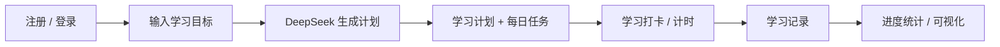
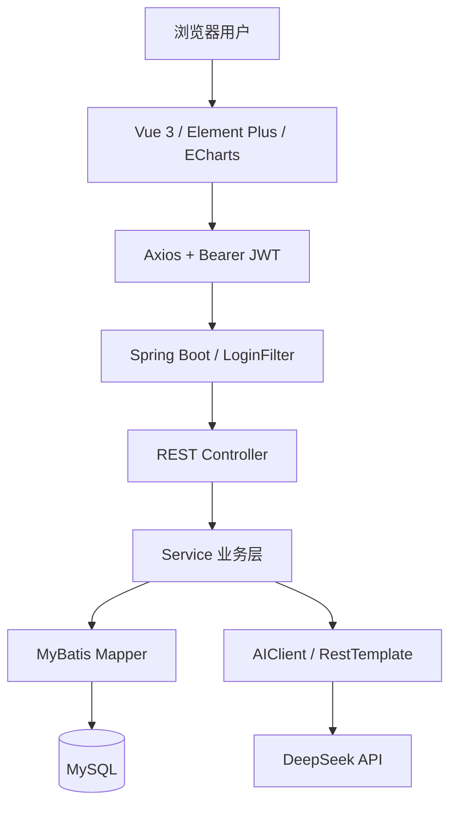
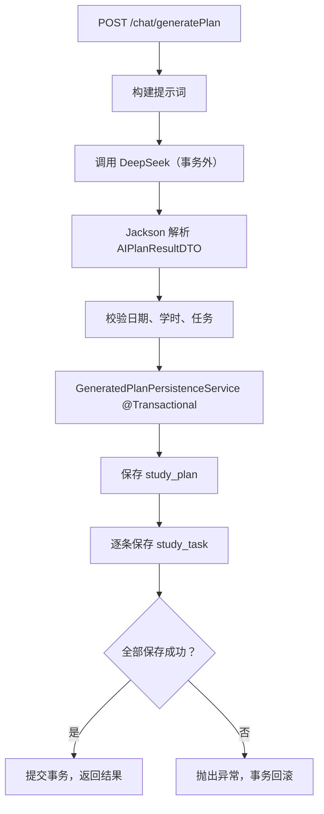
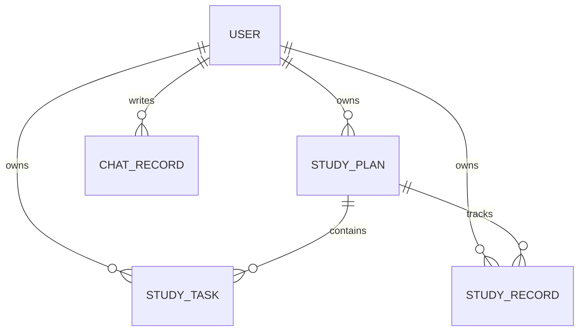

# AI Study Assistant · AI 智能学习助手

<p align="center">
  <strong>从自然语言学习目标，到 AI 学习计划、每日任务、学习计时与数据反馈的完整闭环</strong>
</p>

<p align="center">
  
  
  
  
  
</p>

> **定位**：Java 全栈 + 大模型 API 集成的 AI 应用开发练习项目，覆盖结构化 AI 输出、数据持久化、认证授权和前后端联动。当前项目属于 **AI 应用**，并未实现自主 Tool Calling / 多智能体协作，不将其宣传为完整 AI Agent。

## 📚 目录

- [项目简介](#-项目简介)
- [功能与使用流程](#-功能与使用流程)
- [技术栈](#-技术栈)
- [系统架构与核心流程](#-系统架构与核心流程)
- [项目结构](#-项目结构)
- [快速开始](#-快速开始)
- [主要 API](#-主要-api)
- [数据模型](#-数据模型)
- [工程实现与测试](#-工程实现与测试)
- [项目演示与截图](#-项目演示与截图)
- [已知限制与后续计划](#-已知限制与后续计划)

## 🚀 项目简介

**AI Study Assistant（AI 智能学习助手）** 是一个基于 **Java 21、Spring Boot、MyBatis、MySQL、Vue 3 和 DeepSeek API** 构建的前后端分离学习管理系统。

系统以「输入目标 → AI 制定计划 → 自动拆分每日任务 → 执行与计时 → 查看进度」为主线，帮助用户把一句模糊的学习需求转换为有日期、有内容、可以逐项完成的学习任务，并记录真实学习过程。

**示例场景：** 用户输入「希望在 30 天内系统学习 Java 基础」，后端向 DeepSeek 发送结构化提示词，解析模型返回的 JSON 学习计划，校验日期与任务信息，随后将学习计划和每日任务一起保存到数据库。用户可以继续管理计划、任务和学习记录。

### 核心能力

| 功能模块 | 已实现的功能 |
| --- | --- |
| 账户系统 | 用户注册、登录、个人信息查询与修改；BCrypt 密码哈希；JWT 身份验证 |
| AI 学习对话 | 通过 DeepSeek API 获取回答；加载最近 10 条历史记录构建上下文；保存聊天记录 |
| AI 学习计划 | 依据自然语言生成计划标题、学习周期、目标学时和每日任务；解析、校验并事务化保存 |
| 学习计划管理 | 新建、查看、编辑、删除学习计划；按累计学习时间计算进度 |
| 每日任务 | 添加、查询、删除任务；切换完成状态；创建时校验计划归属 |
| 学习计时器 | 开始、暂停、继续、结束学习；学习满 1 分钟后可保存学习记录 |
| 学习记录 | 选择所属计划、添加、编辑、删除记录；累计学习时长 |
| 数据看板 | 计划数量、学习次数、累计时长、任务完成率与 ECharts 图表 |

## 🔄 功能与使用流程



**典型体验**

1. 注册或登录账号。
2. 在 AI 学习助手中咨询问题，或提交一个学习目标以生成计划。
3. 在学习计划中查看目标学时和学习周期，在任务管理中查看和完成每日任务。
4. 在计划页面开启计时器，可以暂停和继续；结束后填写学习内容并保存。
5. 在学习记录和首页看板中查看累计学习时长、计划进度和任务完成率。

## 🧰 技术栈

| 层次 | 核心技术 | 用途 |
| --- | --- | --- |
| 后端 | Java 21、Spring Boot 3.5.16、Spring MVC、Maven | REST API、依赖注入和业务服务 |
| ORM / 数据库 | MyBatis 3.0.5、MySQL 8.x | SQL 映射与业务数据存储 |
| AI | DeepSeek API、RestTemplate、Jackson | 模型调用、JSON 解析及业务化 |
| 身份与安全 | JWT (jjwt)、BCrypt、Servlet Filter、ThreadLocal | Token 签发校验、密码哈希和请求上下文 |
| 前端 | Vue 3、Vite 8、JavaScript、Element Plus、Vue Router | 单页应用与交互界面 |
| 网络与图表 | Axios、ECharts | HTTP 请求、认证头和统计图表 |
| 测试与文档 | JUnit 5、Mockito、H2 (test scope)、Spring Test、Swagger UI | 单元测试、事务/Mapper 集成测试、接口浏览 |

> 前端依赖中包含 Pinia，但当前核心流程主要使用 Vue 组件本地状态。依赖版本以仓库的 `pom.xml`、`frontend/package.json` 与锁文件为准。

## 🏗️ 系统架构与核心流程

### 前后端架构



后端按 `Controller → Service → Mapper` 分层，并使用 DTO / Entity / VO 区分请求参数、持久化对象与响应数据。登录 Filter 校验 JWT 后，将用户身份放入请求上下文，业务层依据登录用户 ID 访问相关数据。

### AI 生成学习计划



- **结构化输出**：要求 AI 返回约定的 JSON 字段，解析为 Java DTO，并校验计划周期、日期顺序、任务非空等条件。
- **事务一致性**：计划和任务在一个 Spring 事务中提交，防止只保存部分任务造成不完整的学习计划。
- **避免长事务**：DeepSeek 网络请求发生在数据库事务开始之前。
- **任务归属保护**：添加任务采用 `INSERT ... SELECT`，同时匹配学习计划 ID 和登录用户 ID，避免向其他用户的计划写入任务。
- **计时逻辑**：暂停不等于结束，支持继续；记录保存成功后才重置当前计时。

> 当前使用提示词约束 + DTO 校验，不等同于严格 JSON Schema 约束，也不保证模型每次生成都符合要求。

## 🗂️ 项目结构

```text
AI-Study-Assistant/
├── backend/ai-study-backend/
│   ├── pom.xml
│   └── src/
│       ├── main/
│       │   ├── java/com/aistudy/backend/
│       │   │   ├── user/       # 注册、登录和个人信息
│       │   │   ├── chat/       # AI 客户端、对话、计划生成与事务保存
│       │   │   ├── plan/       # 学习计划
│       │   │   ├── task/       # 每日任务和权限校验
│       │   │   ├── study/      # 学习记录
│       │   │   ├── common/     # JWT、统一响应、用户上下文
│       │   │   ├── filter/     # 登录过滤器
│       │   │   └── config/     # 配置类
│       │   └── resources/
│       │       ├── application.properties
│       │       └── application-local.example.properties
│       └── test/              # 单元和集成测试
├── frontend/
│   ├── src/
│   │   ├── api/               # Axios 与后端接口
│   │   ├── components/        # StudyTimer 计时器
│   │   ├── layout/            # 页面布局
│   │   ├── router/            # 路由
│   │   └── views/             # 各业务页面
│   ├── .env.example
│   ├── package.json
│   └── vite.config.js
├── docs/
│   └── schema.sql             # 新环境参考建表 SQL
└── README.md
```

## ⚡ 快速开始

### 1. 环境准备

- JDK **21**
- Maven（Ubuntu 已验证过 Maven 3.9.x；也可尝试项目的 Maven Wrapper）
- MySQL **8.x**
- Node.js **22.12+**、npm（需满足当前 Vite 版本要求）
- 可用的 **DeepSeek API Key**

> **注意**：`docs/schema.sql` 是根据当前 Java Entity 和 MyBatis Mapper 整理的**全新开发环境参考建表脚本**。尚未在全新 MySQL 环境完成端到端初始化验收，也不是现有数据库的迁移脚本。**已有 `ai_study` 数据库不要直接用它覆盖、迁移或清理数据。**

### 2. 克隆仓库

```bash
git clone https://github.com/211irving123456-del/AI-Study-Assistant.git
cd AI-Study-Assistant
```

### 3. 初始化数据库（仅新环境）

在全新、没有业务数据的本地 MySQL 环境：

```bash
mysql -u root -p < docs/schema.sql
```

该脚本创建 `ai_study` 数据库和以下五张业务表：`user`、`chat_record`、`study_plan`、`study_task`、`study_record`。推荐为应用创建权限适当的专用数据库账户，不要在公网部署中使用 root 账户。

如果你已经有可用的 `ai_study` 数据库，**跳过此步骤**，并先确认表结构与当前 Mapper 一致。项目尚未引入 Flyway / Liquibase 等迁移工具。

### 4. 配置后端

在项目根目录：

```bash
cd backend/ai-study-backend
cp src/main/resources/application-local.example.properties \
   src/main/resources/application-local.properties
```

示例文件通过环境变量读取敏感配置：

```properties
spring.datasource.url=jdbc:mysql://localhost:3306/ai_study?useSSL=false&serverTimezone=Asia/Shanghai&characterEncoding=utf8
spring.datasource.username=${AI_STUDY_DB_USER}
spring.datasource.password=${AI_STUDY_DB_PASSWORD}
deepseek.api-key=${DEEPSEEK_API_KEY}
```

`application.properties` 已启用 `local` Profile，并要求另行配置 `AI_STUDY_JWT_SECRET_BASE64`。JWT 使用 HS256，密钥必须是**至少 32 个随机字节的 Base64 编码**，不能使用简单口令、公开示例或原来硬编码的密钥。

Ubuntu / Linux 示例（请在**当前终端**中设置自己的信息；不要把真实密码粘贴到公开日志或提交到 Git）：

```bash
# 在终端中交互输入，不显示数据库密码与 API Key
read -r -p "MySQL username: " AI_STUDY_DB_USER
read -r -s -p "MySQL password: " AI_STUDY_DB_PASSWORD; echo
read -r -s -p "DeepSeek API Key: " DEEPSEEK_API_KEY; echo

export AI_STUDY_DB_USER AI_STUDY_DB_PASSWORD DEEPSEEK_API_KEY

# 当前 shell 会话使用一个随机 JWT 签名密钥
export AI_STUDY_JWT_SECRET_BASE64="$(openssl rand -base64 32 | tr -d '\n')"

mvn spring-boot:run -Dspring-boot.run.arguments="--server.port=8081"
```

- **本地 API**：<http://localhost:8081>
- **Swagger UI**：<http://localhost:8081/swagger-ui/index.html>
- `8081` 是开发示例端口，用于避开其他可能占用 `8080` 的服务；如需使用 `8080`，请同步修改前端 API 地址。
- 每次启动时应使用**同一个安全 JWT 密钥**；随机生成新的密钥会使之前签发的 Token 失效。实际部署应使用环境配置或密钥管理工具持久保存，**不要提交到 Git**。
- 示例配置文件的真实副本 `application-local.properties` 被 Git 忽略；切勿提交真实数据库凭据或 API Key。

### 5. 启动前端

新开一个终端，在仓库根目录执行：

```bash
cd frontend
npm ci
```

Linux / macOS 以 `8081` 为后端地址启动：

```bash
VITE_API_BASE_URL=http://localhost:8081 npm run dev
```

也可以复制 `frontend/.env.example` 为 `.env.local`，然后将其中的 `VITE_API_BASE_URL` 设置为 `http://localhost:8081`，再运行 `npm run dev`。

Windows PowerShell 示例：

```powershell
$env:VITE_API_BASE_URL = "http://localhost:8081"
npm run dev
```

浏览器打开：**<http://localhost:5173>**。

- 后端需持续运行；前后端是两个独立进程。
- 如果使用 VMware 虚拟机，建议先在 **Ubuntu 内部浏览器**访问上述地址。如果从 Windows 宿主机访问，则需要使用虚拟机可访问的 IP 地址并核对 CORS 设置；当前 CORS 白名单针对 `http://localhost:5173`。
- 前端默认 API 地址为 `http://localhost:8080`，可通过 `VITE_API_BASE_URL` 覆盖；它是**构建 / 启动时配置**，不是部署后自动可变的运行时配置。

### 6. 构建和测试

后端（需有本地配置及必要环境变量，部分上下文测试会启动 Spring）：

```bash
cd backend/ai-study-backend
mvn test
```

前端：

```bash
cd frontend
npm ci
npm run build
```

**最近一次人工验收记录（2026-11-22）**：后端 `mvn test` **12 项通过、0 失败、0 错误**；前端 `npm run build` 成功；已在本地浏览器验证登录、学习记录添加、任务添加、学习计时及记录保存等关键流程。此处为已执行的本地验收记录，**不代表 GitHub Actions 持续集成已配置**。

> 之前的 npm 安装报告提示过 **7 个 high severity vulnerabilities**；尚未逐项审计和修复，请以当前执行的 `npm audit` 为准。构建时还可能提示打包体积超过 500 KB，这是性能优化提醒，不等于构建失败。

### 7. 常见问题排查

| 现象 | 优先检查 |
| --- | --- |
| 打不开 `localhost:5173` | Vite 开发服务器是否正在运行，是否在正确的宿主机 / 虚拟机浏览器访问 |
| 请求连不到后端 | Spring Boot 是否启动、是否使用 `8081`、`VITE_API_BASE_URL` 是否一致 |
| Spring 启动提示 JWT 配置缺失 | 检查 `AI_STUDY_JWT_SECRET_BASE64` 是否已导出、Base64 解码长度是否不少于 32 字节 |
| 数据库连接失败 | 检查 MySQL 端口 `3306`、数据库、账号密码和本地配置 |
| AI 请求失败 | 检查 `DEEPSEEK_API_KEY`、模型可用性和到 API 服务的网络连接 |
| 跨设备浏览器出现 CORS 错误 | 核对后端配置中的前端 Origin 白名单 |
| Ubuntu 拉取 GitHub 代码偶发失败 | 先分别测试 `curl -I https://github.com` 与 Git HTTPS 连接；不建议长期硬编码 GitHub IP |

## 🔌 主要 API

后端采用 JSON 请求 / 响应，成功时通常返回如下结构：

```json
{
  "code": 200,
  "message": "success",
  "data": {}
}
```

除了注册和登录，业务接口需要 HTTP 请求头：

```http
Authorization: Bearer <your-jwt-token>
```

以下是当前 Controller 实际提供的 **21 个 REST 接口**：

| 模块 | 方法 | 路径 | 说明 |
| --- | --- | --- | --- |
| 用户 | `POST` | `/user/register` | 注册 |
| 用户 | `POST` | `/user/login` | 登录并返回 JWT |
| 用户 | `GET` | `/user/info` | 查询当前用户 |
| 用户 | `PUT` | `/user/profile` | 修改资料 |
| 用户 | `POST` | `/user/logout` | 提示客户端删除 Token |
| AI | `POST` | `/chat` | AI 对话 |
| AI | `GET` | `/chat/history` | 历史对话 |
| AI | `POST` | `/chat/generatePlan` | 生成学习计划 |
| 计划 | `POST` | `/plan/add` | 添加计划 |
| 计划 | `GET` | `/plan/list` | 查询计划及进度 |
| 计划 | `PUT` | `/plan/update` | 修改计划 |
| 计划 | `DELETE` | `/plan/{id}` | 删除计划 |
| 任务 | `POST` | `/task/add` | 添加任务（检查计划归属） |
| 任务 | `GET` | `/task/list/{planId}` | 查看某计划任务 |
| 任务 | `PUT` | `/task/status` | 更新任务状态 |
| 任务 | `DELETE` | `/task/{id}` | 删除任务 |
| 学习记录 | `POST` | `/study/add` | 添加记录（需要 `planId`） |
| 学习记录 | `GET` | `/study/list` | 查询记录 |
| 学习记录 | `PUT` | `/study/update` | 更新记录 |
| 学习记录 | `DELETE` | `/study/{id}` | 删除记录 |
| 学习记录 | `GET` | `/study/page` | 分页查询 |

### 请求示例

**登录**

```bash
curl -X POST http://localhost:8081/user/login \
  -H "Content-Type: application/json" \
  -d '{"username":"YOUR_USERNAME","password":"YOUR_PASSWORD"}'
```

成功响应中的 `data` 是 JWT 字符串。仅在本地使用自己的测试账户；不要将密码或 Token 上传到公开 Issue、日志或截图。

**AI 生成学习计划**

```http
POST /chat/generatePlan
Authorization: Bearer <your-jwt-token>
Content-Type: application/json

{
  "requirement": "我希望用 30 天学习 Java 基础，每天学习 1 小时"
}
```

**新增学习记录**

```http
POST /study/add
Authorization: Bearer <your-jwt-token>
Content-Type: application/json

{
  "planId": 1,
  "title": "Java 集合框架",
  "content": "完成 List 和 Map 的基础练习",
  "duration": 45
}
```

`planId` 应为**当前用户已有的真实计划 ID**；`duration` 单位是分钟，后端要求不少于 1 分钟。

### 接口与认证说明

- JWT 签名密钥来自环境变量，**不会在仓库中提供可用的真实默认密钥**。
- 缺失或无效 Token 时，登录 Filter 会返回 HTTP `401`。
- 部分业务错误当前返回 JSON 的 `code`，而非一致的 HTTP 4xx 状态；计划在后续统一。
- `/user/logout` 目前不维护服务端撤销列表，前端应主动清除 Token。

## 🗃️ 数据模型



| 业务表 | 关键字段 | 主要用途 |
| --- | --- | --- |
| `user` | `id`, `username`, `password`, `email` | 用户身份与哈希密码 |
| `chat_record` | `user_id`, `question`, `answer`, `create_time` | 对话记录 |
| `study_plan` | `user_id`, `start_date`, `end_date`, `target_hours`, `status` | 学习目标与周期 |
| `study_task` | `user_id`, `plan_id`, `task_date`, `status` | 每日学习任务 |
| `study_record` | `user_id`, `plan_id`, `duration`, `create_time` | 学习内容及计时时长 |

- 学习时长以**分钟**记录，目标以**小时**配置，在计划进度统计时统一换算。
- `study_plan.status`：`0` 未开始、`1` 进行中、`2` 已完成。
- 任务状态以代码中当前使用的 `0` 未完成、`1` 已完成为主。
- 关系图表达的是**业务逻辑关系**，不代表当前数据库已经创建全部外键约束。参考脚本暂未定义外键，请勿以此推断级联删除行为。
- 参考建表脚本位置：[docs/schema.sql](docs/schema.sql)。它不是经过迁移验证的生产 DDL。

## 🧪 工程实现与测试

### 已完成的 5 项关键改进

| 项目 | 改进效果 | PR |
| --- | --- | --- |
| JWT 安全改造 | 从代码中的固定密钥改为外部 Base64 密钥配置，测试 Token 签发与校验 | [#1](../../pull/1) |
| AI 计划事务 | 计划与每日任务同一事务保存，校验 AI 输出，失败时回滚 | [#2](../../pull/2) |
| 学习记录表单 | 新增记录时选择所属计划，传递 `planId`，与后端参数要求一致 | [#3](../../pull/3) |
| 任务归属校验 | 在 SQL 写入时同时验证 `planId` 和当前登录 `userId` | [#4](../../pull/4) |
| 学习计时器 | 规范开始、暂停、继续、结束和保存状态，防止重复提交 | [#5](../../pull/5) |

### 自动化测试覆盖

当前后端有 **12 项通过的测试**，主要包含：

- Spring Boot 应用上下文加载。
- JWT 生成、解码、错误密钥 / 无效签名相关测试。
- AI 计划数据校验、保存成功及任务保存失败的异常传播测试。
- 使用 **H2 内存数据库** 的事务提交 / 回滚集成测试。
- 使用 **H2 + MyBatis** 检查自己的计划允许添加任务、其他用户的计划与不存在的计划不可写入。

测试仍有局限：尚未覆盖完整的 MySQL 端到端场景、并发请求、大模型不稳定返回、全部前端交互及生产环境压测。

### 已验证的本地流程

- 用户登录及 JWT 保护接口。
- 手动添加学习记录。
- 给自己的计划添加任务。
- 开始学习、暂停 / 继续、结束计时并保存记录。
- 后端测试与前端生产构建。

> **说明**：自动化与人工验证都有明确边界。当前未配置 GitHub Actions CI；README 中的本地测试结果不会自动更新。

## 🖼️ 项目演示与截图

项目可展示的页面包括：登录、首页数据看板、AI 对话、学习计划、任务管理、学习记录和学习计时器。

**仓库目前没有正式的真实运行截图或公开在线演示链接**，因此 README 不使用虚构的演示图。建议后续将真实截图（隐藏用户名、Token、API Key 等敏感信息）加入 `docs/images/`，并在此处补充相应展示。

## 🧭 已知限制与后续计划

本项目已完成主要业务闭环及首轮加固，仍是**开发学习与作品展示阶段**，不建议未经额外安全评估就直接暴露到公网。

**近期优先事项**

1. **依赖安全**：核查 npm 报告的高危漏洞、评估可兼容的依赖升级，不盲目使用 `npm audit fix --force`。
2. **配置和部署**：加入经验证的数据库迁移、容器化部署方案、生产 CORS 与密钥管理。
3. **测试质量**：增加 MySQL 环境的回归与并发测试、登录异常和业务错误测试，以及前端自动化。
4. **安全与健壮性**：统一 HTTP 错误码、完善学习记录所属计划的后端权限校验、限制日志中的 AI 返回内容、改进 Token 失效和模型调用异常处理。
5. **用户体验**：优化前端首屏资源体积、移动端布局和大模型响应等待体验。

**中长期扩展方向（尚未实现）**

- AI 响应流式输出与更严格的结构化输出校验。
- 任务提醒、个性化计划调整、学习数据分析。
- RAG 知识库检索或 AI Tool Calling（届时再评估是否升级为 AI Agent）。
- CI/CD、观测指标、在线 Demo。

## 📌 项目说明

这是一个以工程实践为导向的个人学习项目，着重练习：

- 把大模型能力集成到真实业务流程，而不仅是展示一个聊天框。
- 使用 Java / Spring Boot 实现有认证、数据库和明确业务边界的 API。
- 在模型生成内容进入数据库时加入校验、事务和异常保护。
- 通过单元测试、H2 集成测试和浏览器验收逐步改进项目质量。

欢迎通过 GitHub Issue 讨论改进建议。项目是否适合生产部署，应以进一步的安全测试、依赖审计、数据库迁移验证与运维配置为准。

---

**AI Study Assistant** — 让学习计划可以执行，让学习过程可以追踪。
